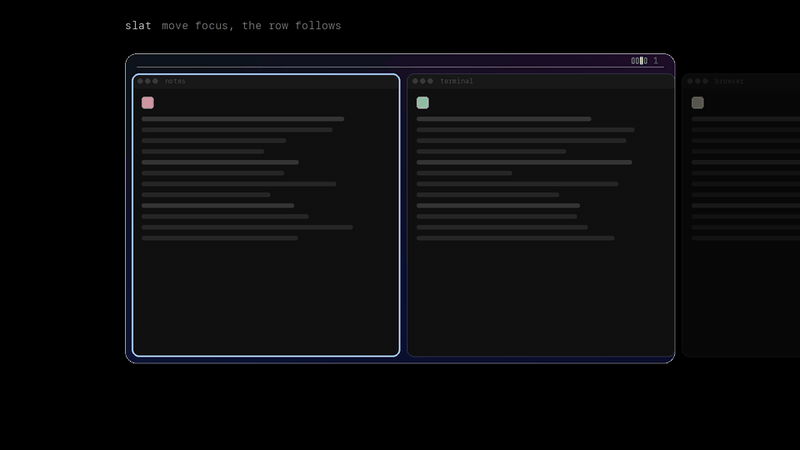
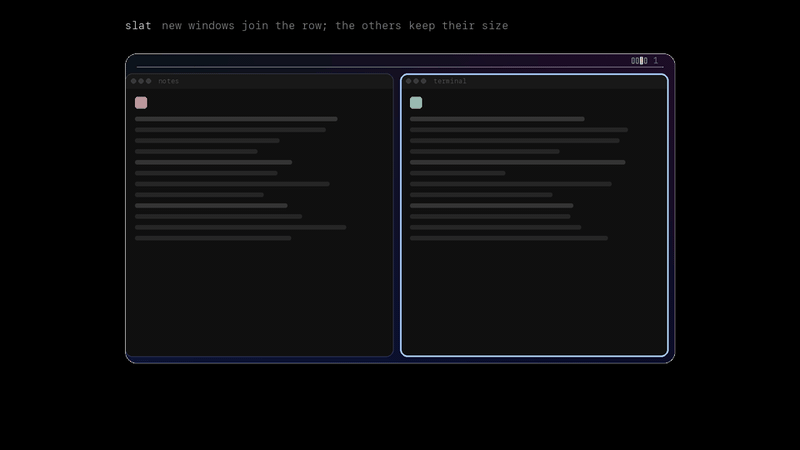
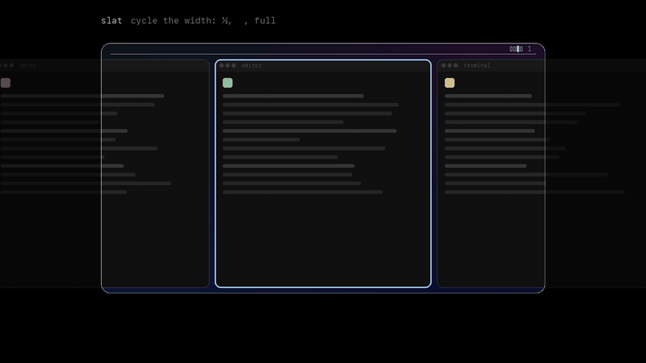
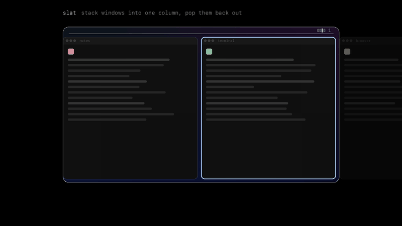
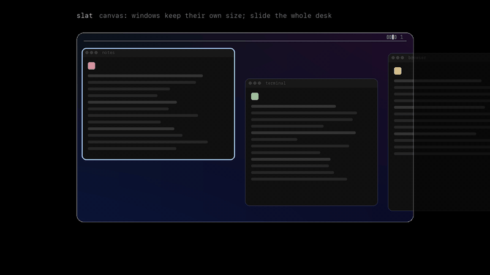

<p align="center"></p>

<h1 align="center">Slat</h1>

<p align="center">Your windows, neatly in a row.</p>

Slat is a scrolling tiling window manager for macOS. Every window gets its own column, and the columns sit side by side in a row that's wider than your screen. Opening a window adds it to the row without shrinking the others, and moving focus slides the row just far enough to show it.

Slat is written in Rust, free, and MIT licensed. It lives in the menu bar and runs its window engine as a separate process, so a crash in one never takes down the other.

## See it move

<table>
<tr>
<td width="50%"><br><b>Move focus.</b> The row slides just far enough to show the window you picked.</td>
<td width="50%"><br><b>Open anything.</b> New windows join the row next to the one you're using. Nothing else shrinks.</td>
</tr>
<tr>
<td><br><b>Move windows.</b> Carry the focused window left or right, one place at a time.</td>
<td><br><b>Cycle width.</b> Step a window through ½, ⅔ and full. Its neighbours make room.</td>
</tr>
<tr>
<td><br><b>Stack.</b> Pile windows into one column, then pop them back out.</td>
<td><br><b>Workspaces.</b> A separate row per task, one above the other. Switching is instant.</td>
</tr>
<tr>
<td><br><b>Swipe.</b> Four fingers on the trackpad slide the row, or hold a key and use the scroll wheel.</td>
<td><br><b>Canvas.</b> Windows keep their own size and spot on one long desk, and you slide the desk.</td>
</tr>
</table>

The keycaps show the default mod key, ⌃⌥. You can switch it to ⌥ or ⌘⌥ in Settings.

## Install

1. Download `Slat.zip` from the [latest release](https://github.com/dyascj/slat/releases/latest) and move `Slat.app` to `/Applications`.
2. Slat isn't notarized by Apple, so the first launch needs a right-click on `Slat.app`, then **Open**. You can also clear the download flag in Terminal:
   ```sh
   xattr -dr com.apple.quarantine /Applications/Slat.app
   ```
3. Grant Accessibility access when onboarding asks. macOS requires it before any app can move other apps' windows. Slat never reads what's inside them.

Updates install from the menu bar with one click. Slat checks GitHub once a day and verifies every download against a signing key built into the app before swapping it in. Each release is signed with the same certificate, so you keep your Accessibility permission across updates.

## Shortcuts

The default mod key is `⌃⌥`. Settings › Shortcuts switches it to `⌥` or `⌘⌥`.

| Keys | Action |
|---|---|
| mod + `H` `J` `K` `L` or arrows | Focus left, down, up, right |
| mod + `⇧` + `H` `J` `K` `L` or arrows | Move the window |
| mod + `R` / mod + `⇧` + `R` | Cycle the width through your presets, or step it narrower |
| mod + `F` | Full width |
| mod + `C` | Center the window |
| mod + `T` | Float or tile the window |
| mod + `⇧` + `T` | Show the column as tabs |
| mod + `[` / `]` | Stack into the column on the left or right |
| mod + `⇧` + `[` / `]` | Pop out of a stack to the left or right |
| mod + `N` | Send to the other display |
| mod + `1`...`9` | Go to a workspace |
| mod + `⇧` + `1`...`9` | Take the window to a workspace |

You can also swipe with four fingers, or hold `⌥` and turn the scroll wheel, to slide the row.

## Features

- **Columns layout.** New windows open at a width you pick (¼ to full). Cycle width steps through presets.
- **Canvas layout.** One long desk. Windows keep their own size and position, and you slide the whole desk. Drag a window anywhere and it stays put. Positions are saved and come back after a restart.
- **Virtual workspaces.** Up to nine rows per display, stacked one above the other inside one macOS Space, so switching is instant.
- **Gestures.** Three- or four-finger swipes with natural or reversed direction and adjustable sensitivity.
- **App rules.** Make an app always float or open at a fixed width.
- **Mac Setup check.** Slat watches for settings that break tiling, like Stage Manager, shared Spaces across displays, or another window manager running, and links to the fix.
- **Focus follows mouse, mouse follows focus, dim inactive windows, gaps.**
- **Custom config.** Flip one switch and edit the engine's `engine.toml` by hand. The engine reloads it on save. An existing Paneru config can be imported.

Settings live in `~/Library/Application Support/Slat/`, and logs in `~/Library/Logs/Slat/`.

## Build from source

You need Rust (stable) and the Xcode command line tools.

```sh
scripts/bundle.sh          # dist/Slat.app for this Mac
UNIVERSAL=1 scripts/bundle.sh   # arm64 + x86_64
```

The repo has two crates:

- `app/` is the menu bar app and its windows (`Slat`). The menu bar uses native `NSStatusItem` menus, and the windows use egui.
- `engine/` is the window engine (`slat-engine`), a fork of [Paneru](https://github.com/karinushka/paneru). See `engine/README.md` for what the fork adds.

Run the tests with `cargo test` in each crate.

## Releasing

Write `release-notes/vX.Y.Z.md`, bump `version` in `app/Cargo.toml`, then push a `vX.Y.Z` tag. CI builds a universal app, signs it, signs the update archive, and publishes the release. Installed copies pick it up within a day.

The workflow needs three repository secrets: `MINISIGN_SECRET_KEY`, `CODESIGN_P12` (base64) and `CODESIGN_P12_PASSWORD`.

## Credits

The window engine is based on [Paneru](https://github.com/karinushka/paneru) (MIT), Copyright (c) 2025 Karinushka@github. Slat is MIT licensed. See [LICENSE](LICENSE).
